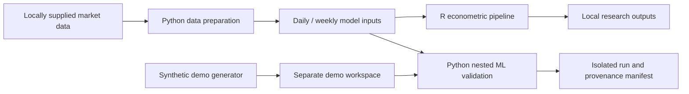

# Vietnam Safe-Haven Research

[](https://github.com/aaaaaaaaaKIN123/vietnam-safe-haven/actions/workflows/ci.yml)

An R and Python research codebase for examining gold and government-bond hedges
for Vietnamese equities. The econometric pipeline combines GARCH-family volatility,
CCC/DCC/aDCC correlations, hedge ratios and stress-state regressions. An additional
ML workflow selects among SJC gold, global gold in VND and a simulated bond TRI
with nested, time-ordered validation.

**Status: research prototype, source release 0.1.0.** The public repository contains
code and a synthetic demonstration. Market datasets, fitted results, manuscript
drafts, downloaded papers and external repositories are excluded.

## Try it without market data

Use Python 3.12 (the locally validated runtime). CI also checks Python 3.13.
Run commands from the repository root:

```bash
python -m venv .venv
# Windows PowerShell: .venv\Scripts\Activate.ps1
# macOS / Linux: source .venv/bin/activate
python -m pip install -r requirements.txt
python -m unittest discover -s tests -v
python tools/demo.py
python tools/demo.py --smoke
```

The default demo checks input construction and label timing without fitting.
`--smoke` fits one eligible outer decision and exercises the output writers.
Both create a new sandbox under `results/demo_runs/`; generated inputs use a fixed
seed and are explicitly labelled synthetic. They never read your market data.
Demo performance is not empirical evidence.

## What is implemented

| Component | Implementation |
|---|---|
| Data preparation | Raw-file audit, daily/weekly panels, sector and bond-term-structure inputs |
| Econometrics (R) | GARCH/GJR/EGARCH selection, CCC/DCC/aDCC, hedge ratios, safe-haven regressions |
| Extensions (R) | Regime switching, connectedness, tail risk, sector and yield-curve analysis |
| Adaptive ML (Python) | Softmax, regularized logistic models and shallow random forests; optional XGBoost |
| Validation | Mature-label cutoffs, purged inner split, train-only preprocessing, dated returns and isolated manifests |

The ML guardrails exclude full-sample DCC/aDCC outputs from predictive selection
and rebuild predictive stress thresholds using past observations. Historical data
vintages and intraday release times remain unverified.



## Run with your own data

See [reproduction instructions](docs/REPRODUCIBILITY.md) and the
[data guide](data/AGENT_DATA_GUIDE.md) for file names, units and transformations.
Install optional Python tools with `python -m pip install -r requirements-research.txt`.
For the R pipeline, install R and run:

```bash
Rscript tools/install_r_dependencies.R
Rscript tools/check_r_syntax.R
Rscript src/models/validate_model_control.R
Rscript src/models/run_model_pipeline.R
```

The final Python ML entry point is:

```bash
python src/models/python/05_adaptive_hedge_ml_final.py --preflight
python src/models/python/05_adaptive_hedge_ml_final.py --smoke
python src/models/python/05_adaptive_hedge_ml_final.py --main
```

Model configuration and method references are in
[`model_control.yaml`](src/models/model_control.yaml) and
[`model_method_map.yaml`](src/models/model_method_map.yaml).
Some legacy and extension runners remain phase-specific; the integrated R runner
does not automatically execute every extension.

## Source layout

```text
src/models/        R model runners, model modules and Python ML workflows
src/diagnostics/   Econometric diagnostics
src/utils/         Configuration, I/O and manuscript utilities
src/visualization/ R plotting helpers
data/scripts/      Data ingestion, preparation and quality checks
tests/             Synthetic regression tests and timing guardrails
tools/             Demo, R setup/syntax validation and source packaging
docs/              Reproduction notes and code review
```

Create a distributable source ZIP with `python tools/package_release.py`.
It uses an explicit file allowlist and includes a per-file SHA-256 manifest.
Archives and checksums are written to `dist/`.

Read the [code review and remaining limitations](docs/CODE_REVIEW.vi.md),
[data and attribution notes](docs/DATA_AND_ATTRIBUTION.md) and
[changelog](docs/CHANGELOG.md) before interpreting results.

Bond TRI series in this project are simulated indices. Log-return-based hedge
combinations and cumulative wealth summaries require the interpretation described
in the review; this release does not establish executable investment performance.
